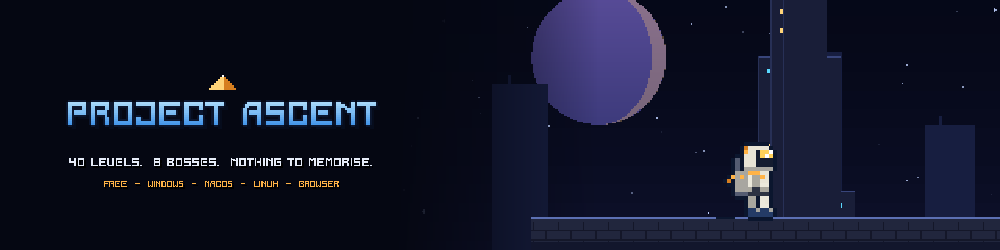

# Project Ascent



Made by **Atharva Patil** ([@p4inz](https://github.com/p4inz-code)) at **P4INZ Interactive Labs**.

Project Ascent is a free, open-source (GPL-3.0) 2D precision platformer with 40 levels. The controls are
tight, retries are instant, and the game is hard on purpose. From level 6 on, each level rebuilds itself
every time you die, and a bot plays every new roll first to prove it can be beaten. PIP, the AI in your
suit, comments on how you are doing. You can donate if you like the game ([Buy Me a Coffee](https://buymeacoffee.com/p4inz),
[UPI for India](https://p4inz-code.github.io/donate/)), but nothing is locked behind it.

## Current status

**v0.17.0 is out.** Play it in your browser on itch.io at
[p4inz-code.itch.io/project-ascent](https://p4inz-code.itch.io/project-ascent), or download it for Windows, macOS
or Linux from the [release page](https://github.com/p4inz-code/project-ascent/releases/latest). Work toward v1.0.0 continues; [docs/ROADMAP_STATUS.md](docs/ROADMAP_STATUS.md)
lists what is done, what is tested and what is still open.

The game plays offline. It has no accounts, backend, ads or tracking. Its only network traffic is the update
check: once a day (or never, or only on request, as you choose in Settings) it asks this repository's GitHub
page for a newer version, over HTTPS, and sends nothing about you. A download is installed only if its SHA-256
matches the checksum published with the release. The check never runs in the browser build. Tester mode writes a
local log that the player copies by hand. See [docs/SECURITY_REVIEW_updater.md](docs/SECURITY_REVIEW_updater.md).

Brand and press assets (logos from 4K down to 16 px, the brand board and the rules) are in
[docs/brand/](docs/brand/BRAND.md).

## Highlights

- **40 levels, 8 acts**: Cinder, Scrapyard, Freezer, Storm, Summit Forge, Underworks, Rift, Core, with a boss every
  fifth level in a different format (lava runner, flood climb, stealth hunt, lightning arena, collapse, black hole, exam).
- **Machine levels**: random multi-route tubes re-rolled each death; roll codes (`--roll=CODE`, `--daily`).
- **Slash + 3 health cells**, three optional cores per level (100 of 108 open the true ending).
- **Taunts that boost your ego**, STRONG/WEAK mode, reaction cards, harmless jump scares (reducible).
- **Updates inside the game**: it checks, downloads with a progress bar, verifies the checksum and asks
  "Restart now / Later"; the launcher swaps the files and keeps a rollback copy (see
  [docs/SECURITY_REVIEW_updater.md](docs/SECURITY_REVIEW_updater.md)).

## What is new in v2 (preview)

- **Tutorial** taught by PIP in five sets (move, jump, dash and slide, walls, the world),
  offered once after the opening story and always skippable; replay it from the title.
- **Plain-road levels** (3, 5, 8, 13, 15, 18, 23): long, mostly flat roads with few jumps,
  where the challenge is twelve kinds of obstacle, re-rolled on every attempt.
- **Random every load:** timing gates and vent pipes land in a different valid set of gaps
  on each level load, and a few ordinary platforms crumble, a different few each time.
- **Boss formats:** road chases (levels 5 and 15), a flood climb (10), a storm of telegraphed
  lightning (20), and a collapsing final climb (25). The floor rises faster near the end of
  every boss countdown.
- **Pools and liquids:** lava, acid and water pools with animated surfaces.
- **Per-act transitions** (airlock, heat flash, frost wipe, warp streak, dawn ascent), with
  the player frozen from the moment the door is touched until the next level is clear.
- **Settings** (Controls, Audio, Video, Gameplay, Character, Access), all searchable, each
  page resettable, every value saved:
  - Access: text size, high-contrast platforms, colour-blind correction, extra ledge grace,
    extra jump buffer, slower hazards, always-full jump height, copy and paste backup.
  - Video: window mode and size (desktop), fullscreen (web), vsync, frame cap, graphics
    quality (AUTO measures your machine), view distance, hold-to-look-around, camera speed.
  - Controls: rebinding, dead zone, vibration, button prompts (Xbox, PlayStation, Switch).
  - Nine interface fonts, four of them bundled open-licence pixel fonts.
- **Fair by construction:** every timed hazard keeps a guaranteed safe window, the storm
  announces every bolt for over a second, and the quality presets only change how things look.
- Desktop (Windows, macOS, Linux) and browser builds; the browser build has no quit button
  and no window options. Consoles are not supported.

## Download and play (Windows)

> **PLAYER DOWNLOAD**: no Godot, no source, no tools required.

1. Go to the [latest release](https://github.com/p4inz-code/project-ascent/releases/latest).
2. Download the **`Project-Ascent-…-Windows.zip`** asset.
3. Extract the ZIP anywhere (all files must stay together in the same folder).
4. Double-click **`ProjectAscentLauncher.exe`** (not `ProjectAscent.exe`) and click Play.

If Windows SmartScreen warns about an unknown publisher, choose **More info → Run anyway**
(the file is an unsigned standard Godot export).

## Controls

| Action | Keyboard | Controller |
| --- | --- | --- |
| Move left/right | A/D or Left/Right | Left stick X |
| Jump | Space or W | A / south button |
| Dash | Shift or J | X / west button |
| Spin (air mobility, brief i-frames) | Double-tap Jump | Double-tap A / south button |
| Slide | S / Ctrl / Down | B |
| Ground pound | Down + Jump (airborne) | B + A |
| Air dash | Dash while airborne | X |
| Wall run | Run into a wall with speed | - |
| Ledge grab | Automatic | - |
| Grapple | E / K | RB |
| Use ability | G / F | LB |
| Restart | R | Back / Select |
| Pause | Escape | Start |
| Show/hide controls | Tab or F1 | D-pad Up |
| Look around (hold) | Up / Z / C / X | Right stick |

## Features

- Responsive running with acceleration, deceleration, and air control
- Jumping with coyote time, jump buffering, and variable height
- Wall slide and wall jump
- Air dash with landing refresh and momentum handling
- Spin: double-tap jump, usable in mid-air, granting brief hazard
  invulnerability on a cooldown
- Six further movement verbs: slide, ground pound, air dash, wall run, ledge
  grab, grapple. Only three claim a key: the rest derive from inputs the player
  already knows, because eleven separately-bound verbs stops reading as depth
- Ledge grab is automatic: it rescues a jump that came up a few pixels short
- Moving platforms, conveyor belts, crumbling platforms, bounce pads, wind
  zones, and one-way platforms (solid from above, pass-through from below)
- Ice and sticky surfaces that change how the ground feels without taking
  control away, ice keeps you sliding after you stop steering, sticky makes a
  run-up genuinely short. Both are ground-only, so a jump off them is still an
  ordinary jump
- Instant-death hazards: spinning blades, swinging pendulums, and lava pits
- Obby gauntlet levels (L2, L7): flat treks over lava broken by jump, dash,
  and spin crossings, instead of pure platform-to-platform ascent
- Every level past 15 carries its own lethal hazard mix, escalating to Act V
- Fast fall respawn, manual restart, attempt counter, and run timer
- 40 levels in 8 acts (Cinder, Scrapyard, Freezer, Storm, Summit Forge, Underworks, Rift, Core). Levels
  6-40 are machines that rebuild themselves on every death; each level has its own jump/dash rhythm
  and every roll is proven passable by a bot
- Bosses every fifth level, each a different format: lava runner (5), flood climb (10), stealth hunt (15),
  lightning arena (20), collapse and heat vents (25), the Hive (30), black hole (35), the echo exam (40)
- Three optional cores per level (108 in the game, 100 open the true ending); slash attack and 3 health cells;
  taunts that mock the play and boost your ego, reaction cards, reducible jump scares, STRONG/WEAK mode
- Roll codes: `--roll=CODE` replays one roll, `--daily` plays the day's seeds; opt-in tester mode with a copyable report
- Mid-level checkpoints in Acts IV and V, in-memory only: they make a long
  level survivable within a session without turning it into saved progress
- Death feedback that escalates past 25 attempts and turns supportive past 50.
  Respawn stays instant at every tier
- Smart boss AI with stuck detection, adaptive jumping, and ledge detection:
  chasers hold an edge or jump a gap they can clear, instead of walking off it
- Every level's jump geometry validated against a measured jump envelope, so no
  step demands more height than the player can actually reach
- Per-level save/checkpoint progression
- Level Select: replay any completed level from the pause menu
- Pause menu with neon panels, action icons, and a shared UI theme
- Cyberpunk pixel font across all UI: menus, HUD, run timer, and controls panel
- Personalisation: 6 player colours, 5 UI accents, and intensity dials for
  screen shake, parallax depth, and neon glow, all applied live, no reload
- Trauma-based camera shake on hard landings and deaths
- Every setting drives real behaviour, verified by a test that asserts an
  observable change in the running game rather than that the value saved
- Procedural city skylines, parallax ridges, star fields, floating particles,
  with per-level shape variation on top of per-act color identity
- Per-act visual identity (Dawn → Dusk → Night → Storm → Apex), each with its
  own sky landmark, a rising sun, a low moon, a banded planet, plus weather:
  snow, driving rain with lightning, and rising embers
- A foreground silhouette layer passing in front of the player for real depth
- Themes: named presets (Ascent, Ember, Frost, Vapor, Toxic, Mono) that
  recolour the player, UI, platform edges and backdrop together. Ascent stays
  the default identity, and the individual colour pickers remain as overrides
- Platform edge glow and atmospheric lighting
- Dash afterimages and player feedback
- Keyboard and controller bindings from Godot's InputMap
- One-charge ability pickups: super jump and glide, spent with the Ability key
- Zero-gravity fields where the player drifts (Act V)
- Every level ~50% longer, extended along its own measured rhythm
- Standalone launcher with update checking, bundled with every release

## Campaign

### Act I, Learn (L1–L5)
Introduction to movement. Jump, dash, precision. Ends with the first boss chase.

### Act II, Master (L6–L10)
Longer levels, tighter precision, movement combinations. Second boss encounter.

### Act III, Survive (L11–L15)
Environmental pressure, demanding routes. Shadow Chase boss.

### Act IV, Endure (L16–L20)
High difficulty, complex combinations. Tempest 2-phase boss.

### Act V, Ascend (L21–L25)
Maximum challenge, endurance, final escalation. Dawn 3-phase final boss.

## Boss encounters

In v2 the five bosses use five different formats (see above); the table is the chase tuning.

| Level | Boss | Minions | Speed |
|---|---|---|---|
| L5 | First Chase | 4 | 170 px/s |
| L10 | Master Escape | 5 | 220 px/s |
| L15 | Shadow Chase | 5 | 200 px/s |
| L20 | Tempest | 6 | 250 px/s |
| L25 | Dawn (Final) | 6 | 300 px/s |

## Save system

- Automatic per-level checkpoint saving
- Progress persists between game sessions
- Reset Progress available from pause menu
- Corrupt save safely falls back to Level 1

## Screenshots

_Pending, owner is providing a fresh set of real screenshots for this section._

## Run locally

### Requirements

- Godot **4.7.2 stable**
- Git

Clone the repository, open it in Godot, and run:

```text
git clone <repository-url>
cd project-ascent
godot --editor --path .
godot --path .
```

On Windows, replace `godot` with the path to your Godot 4.7.2 executable.

## Testing

Run the complete test suite with the bundled wrapper (the slowest suite,
the full 25-level reachability sweep, runs last):

```text
tools/run_all_tests.ps1
```

which runs, in order:

```text
# Game tests
godot --headless --path . --script res://tests/test_boot.gd
godot --headless --path . --script res://tests/test_movement.gd
godot --headless --path . --script res://tests/test_feel.gd
godot --headless --path . --script res://tests/test_loop.gd
godot --headless --path . --script res://tests/test_level.gd
godot --headless --path . --script res://tests/test_level3_route.gd
godot --headless --path . --script res://tests/test_presentation.gd
godot --headless --path . --script res://tests/test_save.gd
godot --headless --path . --script res://tests/test_new_mechanics.gd
godot --headless --path . --script res://tests/test_level_rhythm.gd
godot --headless --path . --script res://tests/test_chaser_ledges.gd
godot --headless --path . --script res://tests/test_new_verbs.gd
godot --headless --path . --script res://tests/test_dev_console.gd
godot --headless --path . --script res://tests/test_customization.gd
godot --headless --path . --script res://tests/test_hazard_placement.gd

# Route and reachability validation (25 levels)
godot --headless --path . --script res://tests/test_all_routes.gd
godot --headless --path . --script res://tests/test_full_campaign.gd
godot --headless --path . --script res://tests/test_all_levels_reachable.gd

# Launcher tests
python -m pytest launcher/tests/
```

All suites pass with zero failures as of the current build.

Two of these suites exist because an earlier gate proved the wrong thing:

- **`test_level_rhythm.gd`** checks that no jump demands more rise than the
  player can actually deliver, using an envelope *measured* from the real
  controller (`tests/probe_max_rise.gd`) rather than assumed from the
  `jump_height` export. The reachability suite passed Levels 9 and 10 despite
  both shipping impossible final jumps, it reached the ledge by wall-jumping
  off that ledge's own face, which proves a bot can get there, not that the
  jump is fair.
- **`test_chaser_ledges.gd`** asserts a chaser stops at a cliff instead of
  walking into it. Three previous fixes for "enemies falling" addressed
  collision layers and a recovery teleport; none of them checked whether there
  was ground ahead, which was the actual cause.
- **`test_new_verbs.gd`** asserts each movement verb produces a real effect:
  a verb that compiles and a verb that works are different claims.

The runner also fails a suite on any GDScript parse or compile error, not just
a non-zero exit code, a suite whose script fails to compile reports
`failures=0` while having asserted nothing at all.

## Architecture

- `scripts/player.gd`: movement state and physics, including dash and spin
- `scripts/player_visuals.gd`: non-authoritative squash/stretch/lean/spin visuals
- `scripts/game_scene.gd`: level loading, transitions, pause overlay
- `scripts/game_manager.gd`: game-wide state, progression, pause, level-select jump
- `scripts/main_scene.gd`: level controller, spawn, boss, completion
- `scripts/level_data.gd`: all 25 level definitions (data-driven)
- `scripts/save_system.gd`: file-based save/load
- `scripts/pause_menu.gd`: pause overlay with settings/progress/level-select
- `scripts/platform.gd`: reusable platform geometry
- `scripts/moving_platform.gd`: oscillating platform that carries the player
- `scripts/conveyor_belt.gd`: constant lateral push while grounded on it
- `scripts/crumble_platform.gd`: triggered one-shot collapsing platform
- `scripts/bounce_pad.gd`: vertical launch pad
- `scripts/wind_zone.gd`: directional force field
- `scripts/one_way_platform.gd`: solid from above, pass-through from below
- `scripts/spinning_blade.gd`: rotating instant-death hazard
- `scripts/pendulum.gd`: swinging instant-death hazard
- `scripts/lava.gd`: static instant-death pit
- `scripts/ui_theme.gd`: the shared UI Theme: palette, type, control styling
- `scripts/camera_shake.gd`: trauma-based camera shake
- `scripts/hud.gd`: controls, timer, attempts, completion UI
- `scripts/audio.gd`: music, SFX, procedural audio
- `scripts/city_silhouette.gd`: procedural background city skyline
- `scripts/floating_particles.gd`: atmospheric floating particles
- `scripts/boss.gd`: boss AI with stuck detection and adaptive jumping
- `scripts/minion.gd`: minion AI with tracking and jump behavior
- `launcher/`: Python launcher/updater, bundled with every release and the
  intended way players start the game (see Download and play above)

## Project structure

```text
scenes/        Godot scenes for levels, player, platforms, UI
scripts/       Runtime GDScript
assets/        UI frames, font, number sprites
tests/         Headless behavior, presentation, and route validation suites
tools/         Test wrapper, web server, probes, and capture scripts
shaders/       Presentation shaders
addons/        Development-only Godot MCP toolkit
docs/          Architecture, design, handoff, and release documentation
launcher/      Optional Python launcher with update checking
build/         Windows standalone build output
```

## License

Project Ascent is free software under the **GNU General Public License v3** ([`LICENSE`](LICENSE)),
with a few additional terms about credit and naming ([`ADDITIONAL_TERMS.md`](ADDITIONAL_TERMS.md)):
keep the author credit, mark modified versions as modified, and give a fork its own name. Every script
carries `SPDX-License-Identifier: GPL-3.0-only`. Third-party parts keep their own licenses
([`THIRD_PARTY_NOTICES.md`](THIRD_PARTY_NOTICES.md)); the licensed Craftpix UI font is not in this
repository and is not covered by the GPL. The bundled `addons/godot_mcp_toolkit/` is a separate
development addon under its own MIT license. Godot and the Godot logo are trademarks of the Godot Foundation.

## Support

The game is free and nothing is gated behind a donation. If you want to chip in:
[Buy Me a Coffee](https://buymeacoffee.com/p4inz) or, in India, [UPI](https://p4inz-code.github.io/donate/).
In the game, CONTRIBUTE TO DEVELOPMENT (pixel heart) is on the main page and the About page.

## Further reading

- [`docs/ARCHITECTURE.md`](docs/ARCHITECTURE.md): technical reference
- [`docs/LEVEL_DESIGN.md`](docs/LEVEL_DESIGN.md): campaign design
- [`docs/SESSION_HANDOFF.md`](docs/SESSION_HANDOFF.md): continuation guide
- [`CREDITS.md`](CREDITS.md): credits and attribution

---

<!-- SUPPORT-BLOCK:START -->
<div align="center">

### Support my work

I make these tools on my own and keep them free. If one helped you, you can chip in by UPI. Any amount.

<a href="https://p4inz-code.github.io/donate/"></a>

`9321614988@jio`

On your phone? [Open the donation page](https://p4inz-code.github.io/donate/).

Outside India, or prefer a card?

<a href="https://buymeacoffee.com/p4inz"></a>

</div>
<!-- SUPPORT-BLOCK:END -->
